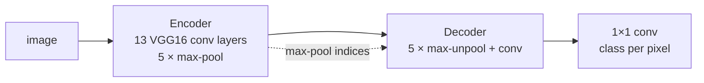

# SegNet semantic segmentation

**Give it a photo and it labels every pixel: road, car, traffic sign, pet or background.**

[](LICENSE)
[](pyproject.toml)
[](https://pytorch.org)
[](https://arxiv.org/abs/1511.00561)

A clean PyTorch implementation of **SegNet**
([Badrinarayanan et al., 2017](https://arxiv.org/abs/1511.00561)), the
encoder–decoder network for semantic segmentation, implemented in plain PyTorch with no
pretrained weights and no segmentation libraries. It trains on toy shapes,
Oxford-IIIT Pet and Mapillary Vistas street scenes, on a CPU or a free
Kaggle/Colab GPU.



SegNet's key idea: the decoder upsamples with the **positions of the max values**
recorded by the encoder's pooling layers. Boundaries stay sharp and the decoder
needs very little memory. See [docs/architecture.md](docs/architecture.md).

## Quick start

```bash
# 1. install (Python >= 3.10)
git clone https://github.com/benisalla/segnet-semantic-segmentation.git
cd segnet-semantic-segmentation
python -m venv .venv && source .venv/bin/activate
pip install -e '.[dev]'

# 2. run the tests (CPU, no network)
pytest

# 3. train on synthetic shapes (CPU, no download)
segnet-train --dataset shapes --image-size 64 --base-channels 16 --shapes-train-size 1000 \
             --epochs 12 --lr 3e-3 --output-dir checkpoints/shapes

# 4. train on real photos: Oxford-IIIT Pet, downloaded automatically
segnet-train --dataset pets --root data --image-size 128 --base-channels 32 \
             --epochs 30 --output-dir checkpoints/pets

# 5. segment your own images
segnet-predict --checkpoint checkpoints/pets/best.pt --images my_cat.jpg
```

**On a GPU:** open [`notebooks/train_kaggle_colab.ipynb`](notebooks/train_kaggle_colab.ipynb)
on Kaggle or Colab, choose the dataset, and press *Run all*.

## Results

**Sanity check (verified by the test suite).** A small SegNet (8 base
channels) memorises 4 shape images in 150 steps: the training loss falls by
more than 4× and pixel accuracy goes above 90%. Run
`pytest tests/test_train.py -k overfit` to reproduce it.

**Simple-data runs.** The `shapes` and `pets` recipes in
[docs/testing.md](docs/testing.md#checks-on-real-data) train the model on toy and
real data. Each run writes its curves (`history.png`) and sample predictions
(`predictions.png`) to its output folder.

## Datasets

| `--dataset` | data | classes |
|---|---|---|
| `shapes` | synthetic circles, squares and triangles, generated on the fly | 4 |
| `pets` | [Oxford-IIIT Pet](https://www.robots.ox.ac.uk/~vgg/data/pets/), pet vs background | 2 |
| `mapillary` | [Mapillary Vistas v1.2](https://www.mapillary.com/dataset/vistas) street scenes, from all 65 classes down to a few you pick (e.g. traffic signs) | 65 or fewer |

```bash
# traffic-sign segmentation on Mapillary Vistas
segnet-train --dataset mapillary --root data/mapillary \
             --classes object--traffic-sign--front object--traffic-sign--back \
             --image-size 256 --dice-weight 0.5
```

Folder layout and all options: [docs/training.md](docs/training.md).

## Project layout

```
segnet-semantic-segmentation/
├── src/segnet/
│   ├── model.py       # SegNet: VGG16-BN encoder, index max-unpooling decoder
│   ├── data.py        # shapes, Oxford-IIIT Pet, Mapillary Vistas datasets
│   ├── metrics.py     # cross-entropy + soft dice loss, pixel accuracy, mIoU
│   ├── train.py       # training loop and the segnet-train command
│   ├── predict.py     # the segnet-predict command
│   ├── viz.py         # colored masks, prediction grids, training curves
│   └── config.py      # every setting, as dataclasses
├── tests/             # pytest: model, data, metrics, overfit sanity check
├── notebooks/         # Kaggle / Colab training notebook
├── docs/              # architecture, training, testing
└── legacy/            # the original 2023 TensorFlow notebook
```

## Documentation

| guide | what is inside |
|---|---|
| [docs/architecture.md](docs/architecture.md) | encoder, decoder, max-unpooling, model sizes, loss and metrics |
| [docs/training.md](docs/training.md) | datasets, Mapillary layout, recipes, outputs, Kaggle/Colab, inference |
| [docs/testing.md](docs/testing.md) | what each test checks and how to re-run the simple-data checks |
| [legacy/README.md](legacy/README.md) | the original notebook and the bugs fixed since |

## History

This project started in 2023 as a TensorFlow notebook trained on Kaggle
([`legacy/`](legacy)). It has been rewritten as a tested PyTorch package. The
model is now a real SegNet with pooling-index unpooling, and several data and
loss bugs in the notebook have been fixed: the training set was replaced by
the validation set, the Mapillary labels were decoded as grayscale, and the
loss was MSE on class ids. [legacy/README.md](legacy/README.md) lists them all.

## Reference

```bibtex
@article{badrinarayanan2017segnet,
  title   = {SegNet: A Deep Convolutional Encoder-Decoder Architecture for Image Segmentation},
  author  = {Badrinarayanan, Vijay and Kendall, Alex and Cipolla, Roberto},
  journal = {IEEE Transactions on Pattern Analysis and Machine Intelligence},
  volume  = {39}, number = {12}, pages = {2481--2495}, year = {2017}
}
```

## Author

**Ismail Ben Alla**: [LinkedIn](https://www.linkedin.com/in/ismail-ben-alla-bai/) ·
[GitHub](https://github.com/benisalla) · ismailbenalla52@gmail.com

MIT License, see [LICENSE](LICENSE).
