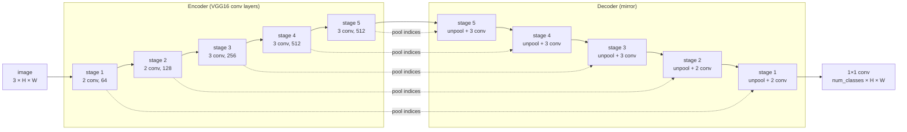

# Architecture

SegNet ([Badrinarayanan, Kendall, Cipolla, 2017](https://arxiv.org/abs/1511.00561))
is an encoder–decoder network for semantic segmentation: it gives every pixel a
class. Code: [`src/segnet/model.py`](../src/segnet/model.py).



## Encoder

The 13 convolutional layers of VGG16, each `conv 3×3 → BatchNorm → ReLU`, in 5
stages. Each stage ends with a `2×2` max-pool, so an `H × W` image becomes an
`H/32 × W/32` feature map. Each pool also returns the **indices**: which of the 4
pixels in every window held the max.

## Decoder

Stage by stage, the decoder mirrors the encoder:

1. **Max-unpooling** with the indices of the matching encoder stage. Every value
   goes back to the position its max came from, and the other 3 positions of
   the window are zero. The result is a sparse map at twice the resolution.
2. **Convolutions** (`conv → BN → ReLU`) fill the sparse map in. The last conv
   of each stage reduces the channels to those of the previous stage.

A final `1×1` convolution gives `num_classes` logits per pixel. Training uses
softmax cross-entropy on them; prediction takes the `argmax`.

```
one 2×2 window      max-pool          unpool (same index)
 1 | 5               5 (index 1)       0 | 5
 3 | 2                                 0 | 0
```

## Why pooling indices

- **Sharp boundaries.** Where the max came from is a few bits of spatial
  detail that pooling would otherwise lose, and the decoder gets it back.
- **Cheap.** U-Net and FCN pass whole encoder feature maps to the decoder,
  while SegNet only stores the indices. The decoder has no learned upsampling.
- **Any input size.** The unpool output size is set from the encoder, so
  sizes that are not multiples of 32 also work (the minimum is 32 × 32).

## Size

`base_channels` scales every stage (`c, 2c, 4c, 8c, 8c`):

| `base_channels` | parameters | use |
|---|---|---|
| 64 | 29.5 M | original SegNet (matches the paper), GPU |
| 32 | 7.4 M | Oxford Pets / Mapillary on a small GPU |
| 16 | 1.8 M | toy data, CPU |

`--dropout` adds `Dropout2d` on the deepest feature map (the paper's
Bayesian SegNet variant uses dropout there too). It is off by default.

## Loss and metrics

[`src/segnet/metrics.py`](../src/segnet/metrics.py):

- **Loss**: `cross_entropy + dice_weight × soft_dice`. Pixels with label 255
  (unlabeled, or the Oxford Pets border) are ignored. Soft dice helps small
  classes such as traffic signs, so try `--dice-weight 0.5` on Mapillary.
- **Pixel accuracy**: correct pixels / labeled pixels.
- **mIoU**: the mean over classes of `TP / (TP + FP + FN)`, from a confusion
  matrix over the whole validation set. Classes that never appear are skipped.
